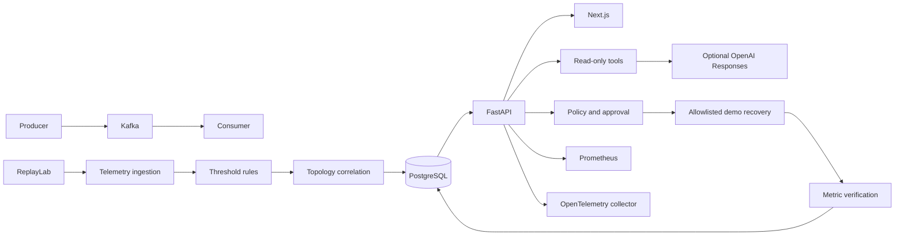
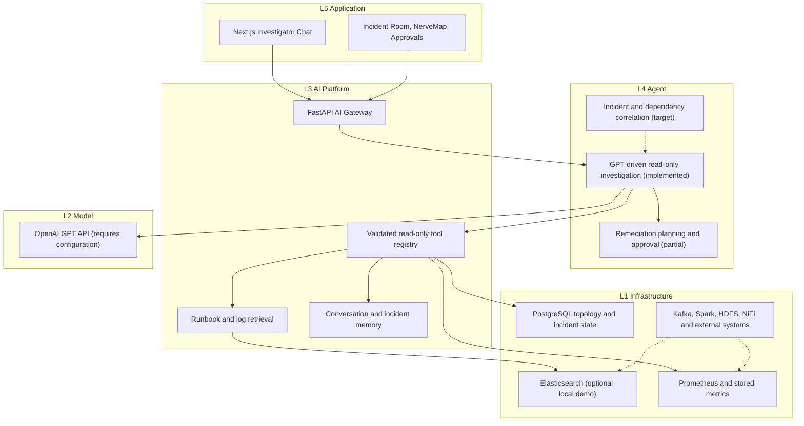

# InvestiNator architecture

The local demo has FastAPI, Next.js, PostgreSQL, a Kafka producer and consumer, Prometheus, and an OpenTelemetry collector. ReplayLab injects **simulated fault telemetry** through the metric and incident workflow. The Kafka workload itself is real; the injected broker fault is not.

SQLAlchemy tables hold incidents, alerts, telemetry, topology, approvals, audit events, replay runs, conversations, knowledge, AI usage, and evaluations. Alembic owns the schema. Data queries filter by the server-derived demo tenant. The client-supplied `tenant_id` on the compatibility endpoint is overridden. Production identity and tenant provisioning are absent.

The incident states include `investigating`, `resolved`, and `closed_unresolved` after a rejected demo action. Approval is a separate gate. Failed verification never closes an incident. The only write action simulates recovery for an active ReplayLab run; unknown action IDs and production commands are denied.

Telemetry observations and runbook suggestions have distinct source and kind fields. Deterministic rules create hypotheses only when evidence exists; otherwise they emit `insufficient_evidence`. The optional model receives bounded, redacted evidence and read-only tool results. A structured response must cite known evidence IDs. Model output never authorizes remediation. See [AI design](ai-design.md) and [security](security.md).

The stack does not connect to production Kafka, Spark, HDFS, NiFi, Kudu, a data catalog, or an enterprise identity system. The Kafka health adapter is read-only. Live platform adapters, real lineage discovery, OIDC/RBAC, retrieval indexing, and production runbook execution remain future work.

## Five-layer AI architecture — target design

InvestiNator aims to detect *upstream originating faults* across distributed
systems, not just explain the symptom emitted by the last failing service.
The following shows architectural **responsibilities**. Some integration
arrows are planned and are not currently implemented.

### Architecture viewpoints and main design principles

- **Context:** Platform engineers, production systems, observability stack,
  OpenAI provider, identity/approval stakeholders.
- **Component:** API gateway, incident service, evidence retrieval, tool
  registry, conversation state, model response validation, policy engine.
- **Deployment:** Docker Compose local demo with optional Elasticsearch;
  authenticated log collection, HA and DR require separate production design.
- **Data:** Immutable evidence references with timestamps and provenance;
  separate real ingestion from seeded simulation, normalize service identifiers,
  and keep tenant-scoped queries and retention policies.
- **Operations:** Capture model/tool usage, tracing and failures, correlate
  alerts by event time and topology, evaluate RCA quality against labeled cases.

### Intended event-driven investigation (future phase)

1. Authorized collectors forward timestamped logs and metrics from services.
2. Deterministic rules detect anomalies and group co-occurring symptoms.
3. Dependency graph identifies plausible upstream failure candidates.
4. The AI investigator retrieves cross-service evidence and tests hypotheses.
5. The incident room shows confidence, supporting and contradictory evidence,
   business impact and suggested read-only checks.
6. Any eventual state-changing action is separately authorized and verified.
7. An approved outcome is incorporated into searchable incident knowledge.

**Current boundary:** Pull-based GPT questions, tools and optional log search
are implemented. Automatic ongoing log ingestion, continuous event correlation,
production topology discovery and autonomous remediation are not yet implemented.
See [Live Investigator](live-investigator.md) for a runnable local demo.
