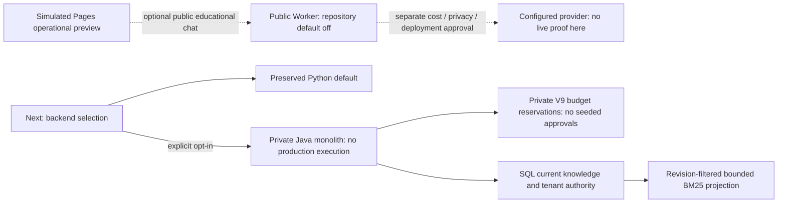
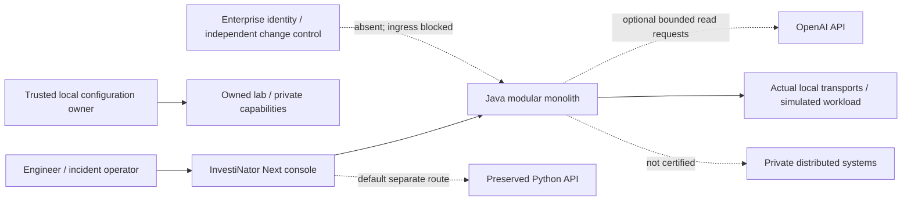
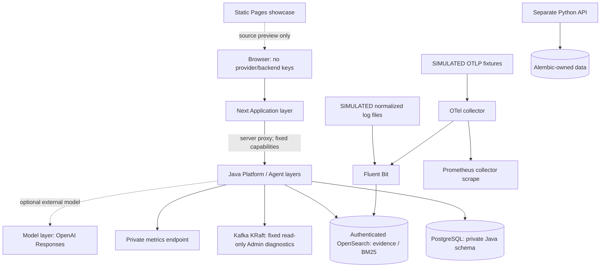

> Prompt14B update: [current report](../implementation/prompt14b/REPORT.md). Newer main
> adds an optional separate public Worker; operational Pages views remain SIMULATED.
> No deployment/live-provider proof or private Java authority is inferred.



# Versioned architecture — v2 handover, 2026-11-19

One Java 21/Spring Boot modular monolith coexists with the preserved Python API.
Next selects Python by default; the owned lab explicitly selects Java. No automatic
schema or production-routing cutover. Source maps below describe current code;
enterprise services/identity are targets with blocked certification.

## Context



## Containers and deployment



Eight owned containers: db, search, kafka, collector, forwarder, prometheus, java,
web. Host binds are loopback. Generated credentials and ports remain in private
`.runtime/lab.json`; volumes survive down. The default Compose Python runtime is
separate. Java metrics are bearer-scoped; Prometheus's existing job scrapes the
collector, not private Java metrics. Proposed alert rules are not auto-enabled.

## Five-layer component map

| Layer | Current modules / responsibility |
|---|---|
| Infrastructure | PG/Flyway, OpenSearch pipeline/BM25, Kafka, collector/forwarder, Prometheus; fixed protocol connectors |
| Model | `model`, `chat/ChatGateway`: official Responses SDK, host/request/time/context/tool/output bounds, encrypted continuation |
| Platform | `api`, `config`, `persistence`, `security`, `health`, `evidence`, `knowledge`, `observability`; scoped records, contracts and diagnostics |
| Agent | `agent`, `correlation`, `monitoring`, `workflows`, `remediation`: deterministic hypotheses/lifecycle, read tools, separate policy/executor/verifier |
| Application | Next operator views and preserved Python UX; explicit provider/source status, scoped evidence and durable plan review |

`ai`, `incidents` and `policy` contain boundary/package declarations; do not describe
them as separate deployed agents. Generated [module/API/config/schema inventory](source-inventory.json)
lists actual source files and conditional route declarations. It is not runtime
OpenAPI or an authorization certificate. Native routes are not all exposed by the
Next proxy; its separate fixed allowlist is in apps/web/lib/gateway-policy.ts. Framework Actuator paths are listed separately.

## Evidence and model data flow

```mermaid
sequenceDiagram
  participant U as Browser
  participant N as Next server proxy
  participant J as Java API / ChatService
  participant T as Scoped read tools
  participant M as Optional OpenAI Responses
  participant D as Private data / current ACLs
  U->>N: Message + conversation/incident association
  N->>J: Bound demo role; caller cannot choose tenant/URL/SQL
  J->>D: Redacted history / encrypted continuation
  alt Provider absent or budget/policy failure
    J-->>N: Explicit deterministic fallback / safe status
  else Explicitly configured provider
    J->>M: Redacted context; read tools; store=false
    M-->>J: Function call(s)
    J->>T: Validate scope, names, arguments, IDs and budgets
    T->>D: Fixed read + current authorization
    D-->>T: Untrusted observation / historical advice
    T-->>J: Bounded result and provenance
    J->>M: Exact call IDs + private continuation
    M-->>J: Structured explanation with validated citations
  end
  J-->>U: Public answer/usage when measured; no private reasoning
```

Logs, normalized evidence, knowledge advice, observations, hypotheses, approvals
and verification are distinct records. PostgreSQL stores immutable graph revisions,
monitor queue/checkpoint/outbox, conversations, citations, approvals/effect receipts
and review-pending postmortems. OpenSearch is evidence/retrieval projection, not the
approval authority. BM25 is not vector RAG. Querying a projection cannot override
current SQL ACL/revision/revocation checks.

## Controlled recovery sequence

```mermaid
sequenceDiagram
  participant P as Planner capability
  participant A as Approver capability
  participant E as Executor capability
  participant V as Verifier capability
  participant J as Java policy
  participant R as Owned ReplayLab resource
  P->>J: Dry-run + proposal with fixed target/parameters
  J-->>A: Immutable hash, risk, version, expiry, pre/postconditions
  A->>J: Approve exact hash (separate capability)
  E->>J: Execute approved plan + idempotency key
  J->>R: Version-fenced SIMULATED effect + durable receipt
  J-->>E: Acknowledged; not resolved
  V->>J: Sample independent current simulator state
  V->>J: Verify exact postconditions
  J-->>V: Resolve only on fresh matching sample
```

Named disk rollback is a new plan/approval/effect/sample. Acknowledgement, GPT advice,
legacy aliases and caller-provided success cannot bypass verification. Tokens do not
prove different people. No network/KRaft/OS/enterprise mutation executor exists.

## Ownership and migration

Flyway V1–V9 owns 40 declared Java tables plus flyway_schema_history in a dedicated
schema (default investinator_java). Python/Alembic remains separate; no shared
migration owner, schema adoption or destructive reverse migration. The 74-step
compatibility trace tests seeded reads and legacy workflows, not every enterprise
contract. New diagnostics/knowledge/monitor/remediation contracts are additive.

Rollback Next routing to Python by selecting python and its existing API URL;
retain Java schema/evidence. Disable Java demo exposure; do not erase volumes or
reinterpret a routing rollback as a data migration. Enterprise cutover is optional
Prompt 16 and requires independent gate verification and user authorization.
