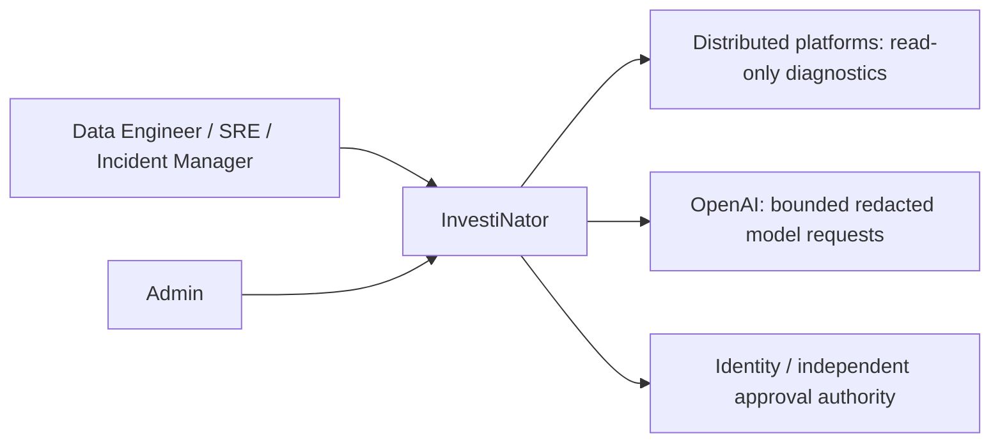
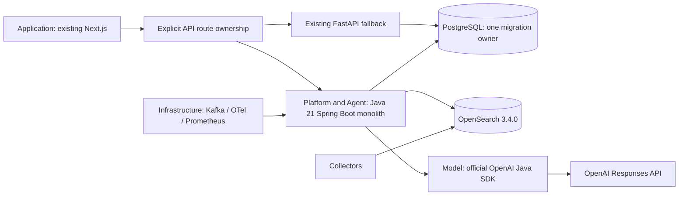
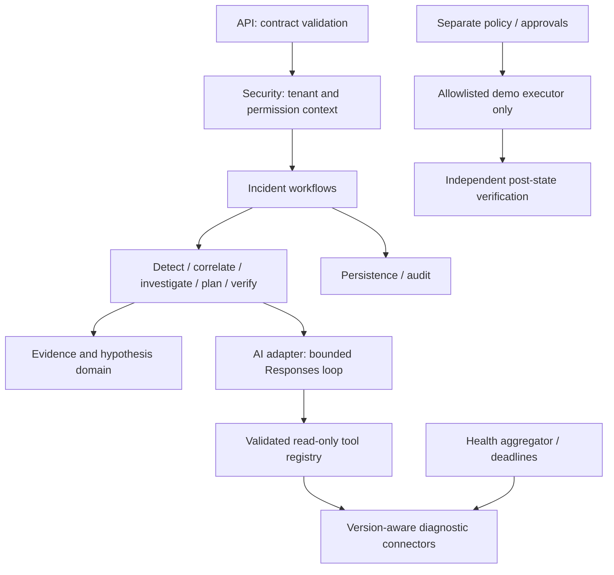

# Proposed architecture and business case

## Problem and requirements

Operators spend incident time stitching together disconnected logs, metrics, topology
and changes. A visible Kafka error may be downstream of network/storage/controller
failure. InvestiNator should reduce manual triage and unsafe speculative fixes while
making every claim inspectable. Benefits remain hypotheses until measured.

Data Engineer: trace stale datasets and failed pipelines to upstream evidence.
SRE: correlate system symptoms, review alternatives and verify recovery.
Admin: configure least-privilege connectors, identity, retention and cost limits.
Incident Manager: track impact, ownership, approved actions and postmortems.

Functional requirements: ingest normalized evidence, bound tenant-filtered diagnostics,
version-aware connectors, dependency graph, deterministic detection/grouping, real GPT
read-only tool loop, persistent follow-ups, ranked hypotheses and contradictions,
separate approval and verification, audit trail and visible provenance/fallback.
Nonfunctional requirements: API compatibility, bounded latency/concurrency/cost,
idempotency, deterministic fixtures, secure identity/TLS/secrets, durable records,
observability, accessible existing UI and tested rollback. Set numeric SLOs after a
measured representative workload; none are established by this audit.

## KPI measurement plan

| Metric | Definition / source | Proposed target direction |
|---|---|---|
| MTTD | first alert minus first observable fault, timestamped incident events | decrease vs measured baseline |
| Mean time to identify | accepted cause time minus detection | decrease; separate hypothesis from confirmed cause |
| MTTR | independently verified recovery minus incident start | decrease |
| False positive rate | adjudicated false alerts / reviewed alerts | decrease without hiding missed incidents |
| Citation validity | existing authorized supporting citations / citations reviewed | 100% valid membership; human support review |
| AI cost/investigation | actual token usage times versioned provider prices | bounded configured budget |
| Triage hours saved | paired operator time against comparable manual incident | positive savings, measured study |
| Recurrence | repeated confirmed cause incidents / observation period | decrease |
| Change failure rate | approved changes causing incident/rollback / changes | decrease |
| Availability | successful core functional requests / eligible requests | SLO to be measured and agreed |
| Auditability | actions with actor, approval, evidence, outcome / actions | 100% for controlled actions |

No operational baseline or financial savings measured. Existing UI timing fields are
not proof of real enterprise MTTD/MTTR. Retain raw timestamps, provenance, cohort/window,
sample counts and missingness when measuring these KPIs.

## C4 context

## C4 containers — target during migration

## C4 components — Java proposal

Domain objects retain tenant, source identity/time and provenance. Observation is a
measurement; Evidence is an authorized referenced record; Hypothesis is a falsifiable
candidate; RootCause requires confirmation. A RemediationPlan is not Approval; an
executor result is not Verification. Enforce these types rather than strings that
silently cross privilege boundaries.

## Data flow / trust boundaries

```mermaid
flowchart LR
  Source[External untrusted telemetry] --> Normalize[Timestamp / redact / deduplicate]
  Normalize --> Store[Evidence store: tenant ACLs]
  Store --> Detect[Deterministic detection and correlation]
  Detect --> Incident[Incident and dependency context]
  Incident --> Tools[Authorized bounded read-only tools]
  Tools --> LLM[Untrusted model hypothesis]
  LLM --> Validate[Citation / schema / policy validation]
  Validate --> Human[Operator review]
  Human --> Approval[Independent approval authority]
  Approval --> Demo[Simulation-only executor]
  Demo --> Verify[Post-state measurements]
  Verify --> Audit[Audit and resolution]
```

Evidence and retrieved instructions cannot override policy. No edge permits the LLM
to invoke production execution. The approval authority is a future requirement, not
implemented by the current fixed demo identity.

## Deployment and operations viewpoints

Current deployment: isolated Compose or direct Python/SQLite plus Next.js; static
Pages showcase separate. Target: local Compose Java/Python coexistence, PostgreSQL,
Kafka KRaft, OpenSearch (ADR-011), collectors and Prometheus. Separate legacy-ZK profile only. Enterprise
requires OIDC/TLS, least privilege, backups/restore, retention, resource limits and
security review. No production deployment has been performed.

Liveness excludes external systems; readiness tests essential DB/core API only.
Diagnostics classify optional dependencies independently and retain source/time/error.
CLI should reuse Compose resources, use bounded waits and preserve volumes on down.
Failure should produce nonzero status and actionable diagnosis, not restart cascades.
OpenAI config checks are free; paid live calls are explicitly opt-in. Start/stop and
failure matrix scripts are planned for Prompt 05; no misleading working CLI is added here.
