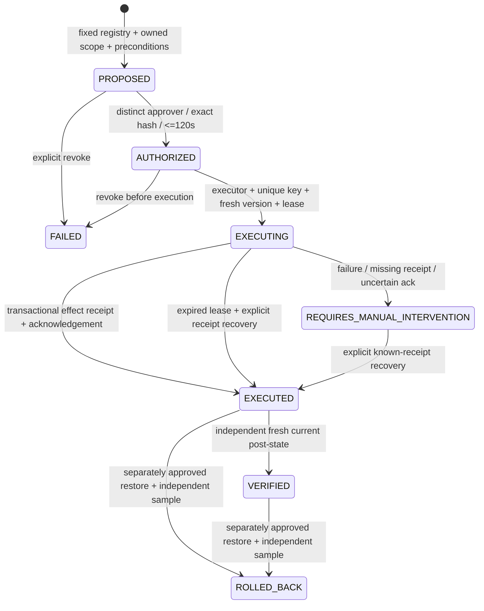

# Governed ReplayLab action state

Approval expiry denies execution; it never silently extends authorization or
re-proposes a plan. Plan lifetime is ten minutes, approval at most two minutes,
execution lease ten seconds, local SQL statements five seconds. No automatic
executor retry is scheduled. Unknown completion requires manual intervention.
A repeated execute call is denied; delivery idempotency is a unique logical effect,
not an invented second success response. Old compatibility aliases retain their
existing behavior only for incidents without a governed plan.

Monitoring lifecycle is distinct: investigating -> awaiting_approval -> mitigating
-> verifying -> resolved. The final transition requires independent verification,
never executor ACK. Source observations remain SIMULATED and are not rewritten as
healthy. Rollback restores the original simulated fault, marks the parent and
restore plan ROLLED_BACK, and closes the incident unresolved; it cannot claim
successful recovery. Postmortems remain pending knowledge review.
