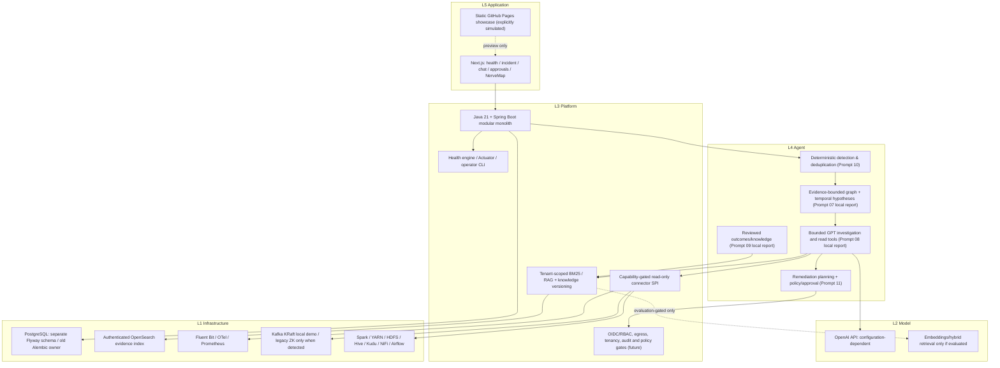

# InvestiNator architecture v2 — post-Prompt 09 target

**Architecture baseline:** 2026-11-17. **Status:** target architecture and user-reported local implementation, **not a statement that Java code is already pushed**. This document is a design contract for the remaining phases.

## Source-of-truth and verification labels

- `VERIFIED_REMOTE`: visible in GitHub `main` or a GitHub Actions run.
- `REPORTED_LOCAL`: described in the user's Prompt 03–09 execution reports, not available in the remote repository for direct inspection.
- `NOT_TESTED`, `NOT_CONFIGURED`, `BLOCKED`: explicit incomplete states; never inferred as success.
- `SIMULATED`: test event or demo fault generated intentionally. An actual transport/protocol carrying synthetic events does not turn those events into production data.
- `LIVE`: a successful real connector/API operation, accompanied by environment, timestamp, authorization and response evidence. Local live and enterprise live remain different scopes.

**Verified remotely at authoring:** `main` has the Python/FastAPI application, Next.js frontend, demonstration and Python GPT integration. Next.js is pinned to 16.4.5; latest main CI and Pages checks passed. `backend-java/` and the Java Prompt 03–09 reports are **not yet on remote main**, nor is `feature/java-ai-audit` published.

**User-reported locally:** Java 21/Spring Boot additive module with Flyway-owned private schema and API parity; OpenSearch ingest/retrieval; `./investinator` health/doctor/smoke command suite; read-only diagnostic connector SPI and Kafka/ZooKeeper fixtures; explainable dependency/time correlation; official OpenAI Java SDK bounded tool loop (no live provider credentials); BM25 versioned knowledge and feedback with 8 proposed evaluation cases. Prompt 09 functional suite reported 78 Java and 14 CLI tests; independent human RCA gold review remains pending. Prompt 05 report was not supplied in this conversation, although later reports refer to its tests.

**Important:** The existing GitHub Pages application is a `SIMULATED` static showcase. It is *not* a deployed Java/FastAPI backend or real GPT endpoint.

## Five AI architecture layers

## Component responsibilities and safety boundaries

| Component | Inputs | Authorized outputs | Must NOT do |
|---|---|---|---|
| Collector | Logs, metrics, spans, timestamps | Normalized tenant+environment+source-mode evidence | Treat missing telemetry as healthy or claim exactly-once without proof |
| Health engine | Authenticated bounded native diagnostic calls | HEALTHY / DEGRADED / UNHEALTHY / UNKNOWN / NOT_CONFIGURED / NOT_TESTED, provenance and reason | Infer full cluster health from an open port |
| Correlation engine | Temporal observations, immutable dependency graph, changes | Ranked hypotheses, alternatives, contradictions, evidence pointers | Declare causation from ordering alone |
| GPT orchestrator | User request, scoped context, allowlisted tools | Evidence-supported explanation, read-only follow-up plans | Raw shell, direct production write, policy/approval bypass |
| Knowledge store | Versioned runbooks, postmortems, reviewed outcomes | Tenant/version-matched retrieval with citations | Promote rejected advice or model guess as verified truth |
| Incident manager | Detection events, incident fingerprints, operator decisions | Durable lifecycle, dedupe, escalation, notifications | Create one incident per log line, open infinite loops |
| Recovery subsystem | Authorized action proposal with fixed schema | Simulated local remediation + independent verification | Execute arbitrary model-generated commands |
| Next.js | Scoped APIs and state | Clear explanation of LIVE vs SIMULATED, confidence, evidence, operator UX | Expose keys or imply static Pages preview is connected to GPT |

### Suggested Java module boundaries

`api`, `domain`, `connectors`, `health`, `observability`, `topology`, `correlation`, `incidents`, `agent`, `model`, `knowledge`, `policy`, `remediation`, `verification`, `security`, `persistence`, `config`.

Prefer **one deployable modular Java service** until scaling, team ownership, or isolation demands distinct services. Kafka is an event transport, not a requirement for every synchronous call. Do not duplicate domain state in UI code.

### Data contracts

Each emitted observation/evidence must retain `tenant_id`, `environment`, `cluster_id`, `service`, `service_version`, `platform_mode`, `entity_id`, `source_mode`, `observed_at`, `ingested_at`, `evidence_id`, `source_pointer`, `sensitivity`, and availability/freshness. Use `UNKNOWN` if information is absent. Idempotent fingerprints must include tenant, environment, signal family, affected resource and normalized event window; cross-tenant deduplication is forbidden.

Distinguish:
1. **Observed**: direct evidence from a particular source.
2. **Hypothesized**: causal explanation supported to a specified degree.
3. **Confirmed**: verified by an authorized owner, evidence and/or controlled experiment.
4. **Recommended**: possible read-only diagnostic or governed action.
5. **Executed**: separately authorized simulation or real action with immutable audit.
6. **Verified**: post-state independent checks, not executor self-report.

A Kafka 4.x KRaft controller failure must never be diagnosed as a ZooKeeper outage. Only detect ZooKeeper on explicitly confirmed compatible legacy Kafka deployments.

## Migration, CI and rollout gates

1. **Publish local Java code** to a remote feature branch after backing up the local work and merging the patched `main`. Never force-push or delete an unknown commit.
2. Preserve Python/Alembic and Java/Flyway schema ownership. Default API route remains on Python unless parity, data migration/rollback and approval gates pass.
3. Java tests in GitHub Actions must compile on Java 21 and run Maven Verify + CLI tests, alongside existing Python and frontend build/audit.
4. Isolation, denial, negative tests, startup and smoke must pass. Model inference is not a production action.
5. Prompt 09 human gold review is an explicit **BLOCKED/PENDING** measurement gate; local fixture tests do not establish measured RCA quality.
6. Prompt 10 development may proceed behind a feature flag, but automatic external monitoring/notifications remain disabled without explicit operator configuration.
7. Production go-live needs OIDC/RBAC, secrets, TLS/mTLS, HA/DR, retention, data privacy/legal review, connector certification, observability, SLOs, load tests and approval. No “production ready” claim until signed off.

## Execution references

- [Updated prompts after Prompt 09](POST_P09_PROMPTS_V2.md)
- [Safe handoff of local Java code to GitHub](SYNC_JAVA_WORKTREE.md)
- [Current repository README](../../README.md) — as-is Python stack and demo. The previous complete 00–15 prompt chain was provided separately in the conversation; this repository document supersedes stages 09A onward.
