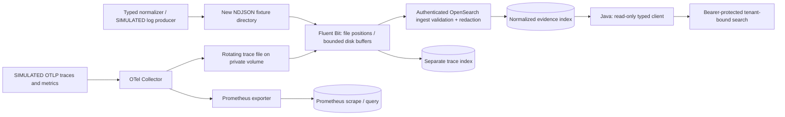

# Local normalized evidence data plane

This opt-in lab uses OpenSearch 3.4.0, official OpenSearch Java client 3.11.0,
Fluent Bit 4.2.2, OTel Collector contrib 0.121.0 and Prometheus 2.55.1. Images
are digest-pinned. Official client compatibility lists Java 3.x for OpenSearch 1–3
and JDK21: https://github.com/opensearch-project/opensearch-java/blob/main/COMPATIBILITY.md.

Elasticsearch 9.5.5/Java SDK was evaluated first. It cannot bootstrap on this cloud's
kernel because /proc/self/coredump_filter is absent; supported 9.4/9.2 branches also
require it. OpenSearch starts with authenticated security enabled on this runtime.
No kernel interface was faked, no signature/TLS check disabled and no production
cluster changed. The lab's plain HTTP is restricted to a private Docker network and
host loopback; enterprise ingestion remains disabled until identity/TLS review.
OpenSearch's bundled demo security configuration/certificates are **demo only**.

## Flow and ownership



Data-plane credentials are writer-only; Java receives only the reader credential.
Bootstrap admin credentials are used solely by the local setup helper, never by
Java, GPT, the UI or query requests. The writer cannot search; the reader cannot
write. The API credential binds to the configured server demo tenant, not a caller
header/query. No browser or model can supply a destination URL, index, raw DSL or
production command. Search is a bounded plain-text multi-match plus exact tenant,
time and optional service filters. Page size <=50, offset <=1000, window <=4 hours,
server timeout 2s, transport timeout 3s and automatic HTTP retries disabled.

Normalized JSON schema: schema.json. It distinguishes event and ingestion time,
source provenance, service/host, trace/span, resource/cluster, error and source
pointer. event.original is bounded and redacted; the ingest pipeline performs a
second redaction pass. IDs hash tenant/source pointer/event time, so retries use
the same document ID. Create-only indexing refuses overwrites. Source URLs are
references only and are never fetched. LIVE retrieval can return SIMULATED data;
the API reports both separately and verifies each source ID/tenant/timestamp.

Event ordering is by event time plus ID, not file arrival order. Old/future events
retain their source timestamp and receive LATE_ARRIVAL/FUTURE_CLOCK_SKEW flags.
Unknown fields fail strict mapping; missing normalized identity/provenance is
rejected by the pipeline. Schema version 1 is explicit; bootstrap refuses unknown
versions rather than silently rewriting existing data. Invalid documents are not
successful ingestion. Inspect forwarding errors and dropped/retry counters; no
production dead-letter/replay guarantee is claimed.

## Verification (disposable, local Docker only)

From repository root, with JDK21, Maven Wrapper dependencies and local Docker:

```bash
./backend-java/mvnw -B -f backend-java/pom.xml verify
python3 backend-java/scripts/evidence_lab.py verify
```

The helper creates only randomly named test resources, generates ephemeral strong
credentials without printing them, uses real collectors/index/metrics services,
and removes only its own containers/network/anonymous test volumes. It never runs
`down -v` against the application stack. Diagnostics on failure live under ignored
backend-java/target/evidence-lab-logs. HTTP and transport requests are bounded.
Provider access is disabled; no OpenAI call or infrastructure remediation occurs.

## Retained local demo (explicit opt-in)

Supply these securely through the local process environment or ignored env file:
EVIDENCE_ADMIN_PASSWORD (strong OpenSearch admin password), EVIDENCE_WRITER_PASSWORD,
EVIDENCE_READER_PASSWORD and EVIDENCE_API_TOKEN. Do not paste values into chat or
commit them. Configuration files contain only variable references.

First build the jar and generate a **new** fixture directory. Generation uses
CREATE_NEW to preserve existing files:

```bash
java -cp "backend-java/target/classes:$(cat backend-java/target/runtime-classpath.txt)" com.investinator.evidence.EvidenceFixtureGenerator backend-java/target/evidence-fixtures
```

Start only the search service, then prepare its local schema/roles with the helper:

```bash
docker compose -f docker-compose.yml -f compose.java.yaml -f compose.evidence.yaml --profile java --profile evidence up -d evidence-search
python3 backend-java/scripts/evidence_lab.py bootstrap --port 19200
```

Bootstrap requires search readiness; if the local node is still starting, wait for
its authenticated health, then rerun. Bootstrap is idempotent for schema v1; it
never deletes data. Next start the collectors, Prometheus and Java:

```bash
docker compose -f docker-compose.yml -f compose.java.yaml -f compose.evidence.yaml --profile java --profile evidence up --build -d evidence-collector evidence-forwarder evidence-prometheus java-api
```

Do not route the whole Next.js app to this health-only mode. Add compose.persistence.yaml
and its password/profile when evaluating the complete Java deterministic demo.
The default Python and Next.js services remain untouched. Normal stop preserves data:

```bash
docker compose -f docker-compose.yml -f compose.java.yaml -f compose.evidence.yaml --profile java --profile evidence stop java-api evidence-forwarder evidence-collector evidence-prometheus evidence-search
```

Keep named evidence volumes for restart/resume. Forwarder file offsets and bounded
chunks persist; do not edit files already consumed as though they were new events.
Its five retries and 100MB-per-output storage bounds prevent unbounded growth; a
prolonged outage/full buffer can drop data and must be surfaced operationally.
Trace files rotate at 10MB with three backups / seven days, explicitly for this
local demo. Search's seven-day ISM policy is defined but not attached by default.
Applying deletion retention requires the explicit helper flag
`--confirm-seven-day-retention-deletion`; inspect data/backup requirements first.

Collector OTLP, health and forwarding inputs have no public host ports in retained
Compose. Search/Prometheus/Java publish loopback only. Collector runs as container
root only to own its private named trace volume; it is not privileged and has no
host trace/log mount. Production file permissions, authenticated ingress, secret
rotation and least-privilege deployment need their later security gate. Cloud
proxy variables remain intact; no_proxy/NO_PROXY append only private service aliases
so intra-network forwarding does not go through external egress.
